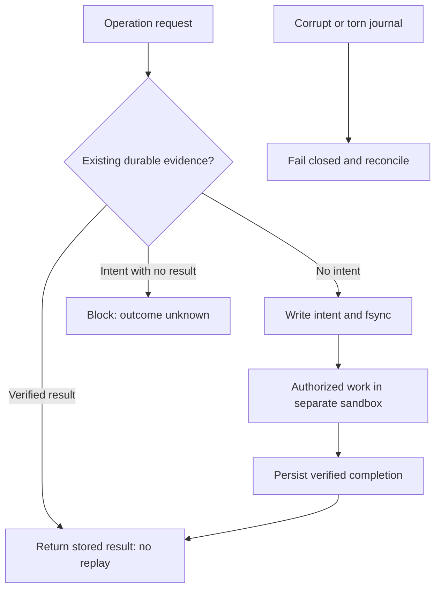

# Agent Reliability Lab

**Practical demonstrations of crash-conscious AI-agent infrastructure and verifiable automation.**

This repository contains **original, standalone educational code** for Python/Linux. It is intentionally smaller than the private engineering system behind the author's professional projects, and contains **no customer data, production secrets, private source code, or paid inference dependencies**.

## What you can verify in under a minute

```bash
python3 --version
python3 -m unittest discover -s tests -v
```

**Current result:** 11 tests passing on Ubuntu/WSL with Python 3.12. This public repository demonstrates:

- Hash-chained, append-only JSONL event records
- Multi-process append serialization using Linux `flock`
- Idempotent, content-addressed completion evidence
- Detecting deleted, modified, or truncated journal records
- A fail-closed `OutcomeUnknown` state when an intent survives but completion does not
- Verified reconstruction of already-completed operations without executing them again

## Architecture



**Important:** This public sample intentionally does not execute untrusted agent code, integrate an LLM, manage production secrets or provide an external side-effect idempotency guarantee. It shows the *journal and recovery decision primitives*. Real at-most-once dispatch also needs a lock that spans evidence inspection and the complete execution/commit boundary, plus proof of effects or external idempotency keys.

## Why this matters

Automation rarely fails in the happy path; it fails between durable operations. For example, a runner may crash after dispatching a payment or support workflow but before writing a receipt. Blindly retrying could duplicate a payment, customer response or account action.

A reliable automation framework must distinguish:

| Durable state | Safe treatment |
| --- | --- |
| No intent | May admit a new operation |
| Intent, no verified completion | **Outcome unknown — block blind retry** |
| Verified matching completion | Reconstruct without re-execution |
| Evidence corruption | **Fail closed; reconcile independently** |

For operations with external side effects, no internal journal can prove exactly-once effects without an external idempotency contract or independent reconciliation.

## Selected private engineering work

These projects are described here as **technical case studies**, not as publicly reproduced code.

### Adinkra ICM — Autonomous engineering reliability

Designed and evaluated a multi-stage engineering harness using Python, TypeScript, Git commit receipts, independent candidate verification, Landlock sandbox attestations, append-only journals, fault injection, durable retry identities and reviewer/implementer separation.

Recorded qualification milestones include a four-stage synthetic lifecycle with four intentionally rejected proposals and acceptance on the fifth repair attempt; multiple real SIGKILL/restart scenarios; a tested independent retrospective verifier; and a 139-test recovery/handoff suite on a committed WSL revision. These are from the private project and are **not** assertions about the 11 tests in this public sample.

Engineering lessons: a Git object is not an accepted ref; a journal projection is not authority; a surviving intent without proof of completion is not permission to retry; an independent verifier must remain separate from the implementer.

### Efficient Labs — Workflow and API reliability

Built and audited automation components around Cloudflare Workers/D1, inquiry routing, idempotency, reviewer-gated workflows and deterministic evidence capture. Production customer outcomes and revenue are **not** implied by the engineering demonstrations.

### Local agent coordination

Implemented a revision-bound reviewer handoff design, exclusive writer leases, audit receipts and failure/recovery tests. A deterministic review demonstration is not the same as fully unattended model-to-model authorization.

## Engineering practices

- Reproducible tests before "done"
- Evidence and source revision pinning
- Explicit infrastructure-vs-candidate failure classification
- Least-privilege execution and isolated tools
- No secrets or private data in source repos
- Honest limitations and clear escalation for unknown outcomes

## Repository contents

```
agent_reliability/journal.py     # standalone journal + crash-state API
tests/test_journal.py            # independent functional and concurrency tests
docs/                           # engineering notes and boundaries
```

## Scope and licensing

This demonstration is for review, technical interviews, and education. **No license is granted to redistribute or use its code commercially** unless a license is later added by the owner. Please do not mistake it for the complete private Adinkra ICM system.
